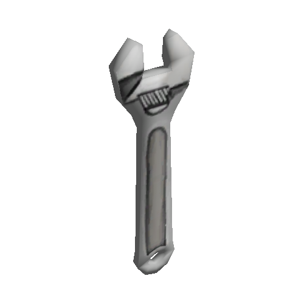
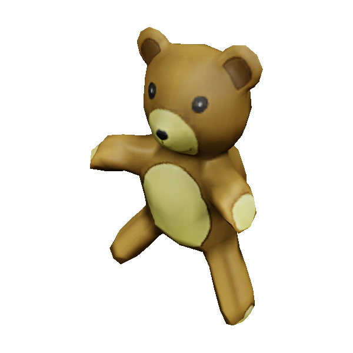
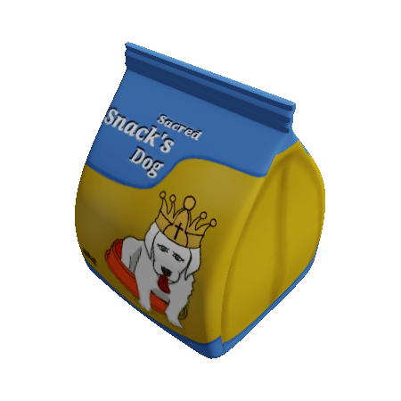
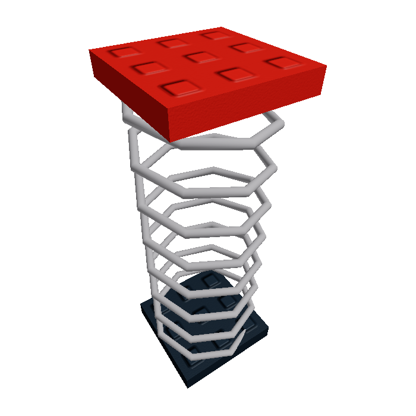
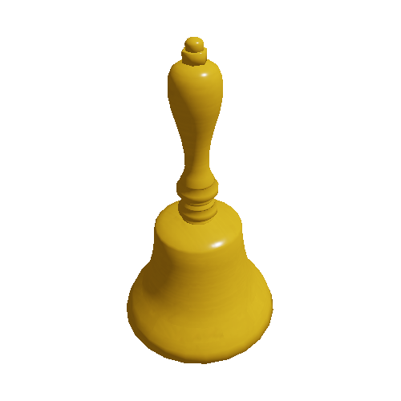
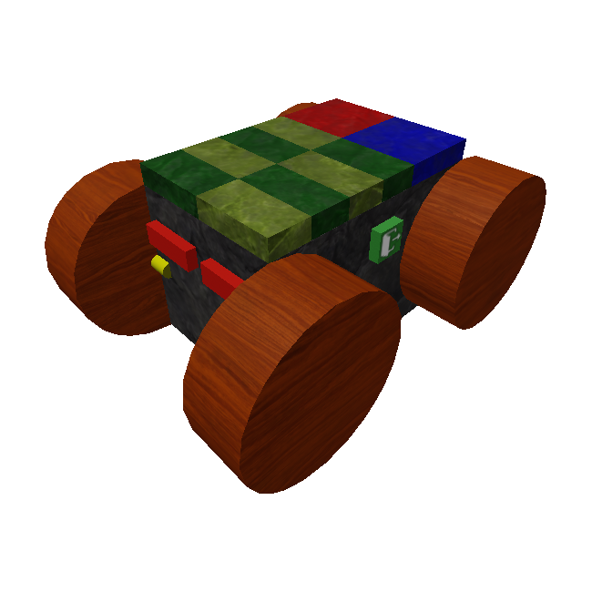

# Hotel Rescue: Postmortem

The recommended way of reading this is to plug it into an AI and talk about it. It's also for the rare type that still reads books!

This document is for players first, nerds second. I shall start with the what's before the why's.

This document may or may not be up to date. Check for its latest update on the online repo or through the link below.

[hotel-rescue-rbx on GitHub](https://github.com/tristan-bonaobra/hotel-rescue-rbx)

## Introduction

`POSTMORTEM.md` talks about all the features and design decisions behind Hotel Rescue in the form of a **retrospective**. This should tell you just about everything about the game as of its current state and why I thought it up that way.

I write this now because the design philosophy has been behind everything added to the game thus far and it's been bugging me. I figured that it counts as source code, and this _is_ open-source. Believe it or not, there's some real consideration behind this!

### Where Can I Play?

As of writing this, there is currently no publicly playable version of the game on Roblox! The reason for this is to minimize any link between my IGN and my real-world identity for the sake of privacy. I could upload it on a throwaway account, but you wouldn't be able to play it anyway, unless you've somehow already given Roblox your biometrics for voice chat. [Creator Documentation](https://en.help.roblox.com/hc/en-us/articles/203313890-How-to-Publish-Games-on-Roblox)

To play, you'll have to set it up yourself with this [usage guide](README.md). If you do and your upload takes off, I'd be happy just knowing that others see the vision!

### What is Hotel Rescue?

Hotel Rescue is a Roblox game that takes a fresh spin on the popular "disaster survival" genre. Think [Natural Disaster Survival](https://www.roblox.com/games/189707/Natural-Disaster-Survival), [Survive the Disasters](https://www.roblox.com/games/18540115/Survive-The-Disasters), or [Survive the Evil Disasters](https://www.roblox.com/games/140113362796255/Survive-The-Evil-Disasters), but with a heroic twist: instead of simply surviving the earthquake in question, you must return to the rubble and bring NPCs to the safe zone, too!

The primary loop looks like this:

1. Wait for the story and disaster to play out.
2. Teleport to the map and search for the 30 NPCs.
3. Make good use of a wide selection of tools such as the [Super Pick](#super-pick) and [Pull Wrench](#pull-wrench) to move debris out of the way.
4. Work with other players to bring all the rescues back to the big, green finish line.
5. Use the points to purchase even more gear.

Be careful, though, as the NPCs may not be as super or smart as you!

## Chapter I: Gears and Economy

The gears in this chapter shall be sorted roughly according to the order in which the gears were created.

### Points Economy

Players join the server with 10 points. For rescuing an NPC, you earn 3 points—1 if they're unconscious. Though, some NPCs reward more:

| NPC Type | Reward |
| :--- | :--- |
| Unconscious (Any) | 1 Point |
| Conscious (Normal) | 3 Points |
| Conscious ([Panicked](#panicked-npcs) or [Dizzy](#dizzy-npcs)) | 5 Points |

Meanwhile, gears are priced according to standard tiers:

| Price Tier | Points | Gears |
| :--- | :--- | :--- | 
| Spawn | 0 Points | [Super Pick](#super-pick), [Pull Wrench](#pull-wrench), [Teddy Bear](#teddy-bear) |
| Starter | 10 Points | [Dog Treats](#dog-treats), [Gravity Coil](#gravity-coil), [Brickmobile](#brickmobile) |
| Substandard | 20 Points | [Power Piston](#power-piston), [Wooden Platform](#wooden-platform) |
| Standard | 30 Points | [Power Bell](#power-bell), [Rally Flag](#rally-flag), [Translocator](#translocator), [Freeze Ray](#freeze-ray) |

That is to say, it takes 4 good rescues to be able to purchase, say, a [Power Bell](#power-bell). Alternatively, you could purchase a starter gear right away, at the opportunity cost of choosing one starter gear over others and not being able to purchase a higher-tier gear until much later, at 10 good rescues. Still, this is the recommended option for most maps.

| Map | Recommended Gear | Reason |
| :--- | :--- | :--- |
| [Disaster Hotel](#disaster-hotel) | [Dog Treats](#dog-treats) | Lots of small rooms that could be hiding NPCs. |
| [End of Roblox](#end-of-roblox) | [Gravity Coil](#gravity-coil) | Reach NPCs on roofs. |
| [Underground Base](#underground-base) | None (Save points) | If you can tear down the doors resourcefully using just the [Super Pick](#super-pick) and [Pull Wrench](#pull-wrench), and you know where the good spots are, then this map is perfectly doable without additional gear. |
| [Prison Panic](#prison-panic) | None (Save points) | This is an easy map with a lot of freebies. You can get a lot of value without purchasing gear. |
| [Robloxian High School](#robloxian-high-school) | [Gravity Coil](#gravity-coil) | Reach NPCs on high surfaces. |
| [Town of Robloxia](#town-of-robloxia) | [Dog Treats](#dog-treats) | Large map with a lot of structures means it might be harder to find NPCs. |

The above chart assumes that you are a new player that hasn't yet mastered the [grapple](#pull-wrench). Feel free to ignore it, though, as the game is designed to be possible* with just the spawn gear.

You could argue that since an unconscious survivor takes considerably more effort to retrieve, it should be worth as much or even more points. But the _point_ is to prevent players from skipping the "be careful" half of the game by simply pushing NPCs off a high ledge for free.

As an above-average player in terms of skill and experience I can consistently get between 10 and 15 out of the 30 NPCs each round. Of course the vast majority of players will not be anywhere as skilled as me, but the hope right now is that it would be balanced by having more players in the server. As for early playtests where there would often only be the playtester, c'est la vie.

### Super Pick

| Icon | Details |
| :--- | :--- |
|  | **Appearance**: A hammer with a yellow shaft and black handle. It shares the same model as the classic [Delete Tool](https://roblox.fandom.com/wiki/Catalog:Delete_Tool). **Effect**: Breaks parts in half at each dimension greater than a threshold (currently 3 studs). If no dimension is greater than the threshold, or the part is otherwise incalculable (e.g. a truss, cylinder, or corner wedge), it is instead "crushed" into sand, clipping out of the map. **Sound**: A light, high-pitched sound of a hard object breaking, with a subtle pitch shift. If the Super Pick misses or otherwise tries to interact with an invalid part, it is instead a windy swing, similar to the [Linked Sword](https://www.roblox.com/catalog/125013769/Linked-Sword). **Niche**: Many parts are welded to surrounding walls or are otherwise too big to pull as they are. Breaking down debris is often the first step to moving it out of the way. **Value**: 0 (Obtained by spawning). Breaking debris is a fundamental mechanic and the game is unplayable without it, especially on [Underground Base](#underground-base), where the entrance is literally blocked. |

I remember that I wanted there to be a clear visual indicator that a part was broken, otherwise you couldn't tell that the part in front of you had actually become four parts. A red dot at `mouse.Hit`? Too vague. A subtle `SelectionBox`? Varies with lighting. A cracked decal? Too ugly. Eventually I settled for random tint. I figured that the discoloration added to the destruction aesthetic while looking colorful and whimsical. After some experimentation I decided that simply changing the value slider looked better than changing hue, which looked like vomit.

As for implementation, simple enough—just use the existing `breakPart` function. Of course, there was the question of what counts as parts you were allowed to break—we can't have players breaking the spawn island, accidentally or not. The core logic is that the part had to be inside `CurrentMap` which is a line of thought that would eventually run through almost every other gear that would be added.

### Pull Wrench

| Icon | Details |
| :--- | :--- |
|  | **Appearance**: A grey crescent wrench. It shares the same model as the classic [Configuration Tool](https://roblox.fandom.com/wiki/Catalog:Configuration_Tool). **Effect**: Ties a `SpringConstraint` between the user's `HumanoidRootPart` and the target surface. Upon disconnecting, it applies a small impulse to the player towards the other end of the "grapple". **Sound**: A heavy, stringy, bouncy sound, specifically the iconic [bass.wav](https://create.roblox.com/store/asset/12221944/basswav) used in the [Trowel](https://roblox.fandom.com/wiki/Trowel). **Niche**: It is the primary tool for tearing down debris, pulling unconscious NPCs to the finish line. In more advanced playthroughs, it is also the primary means of vertical mobility.  **Value**: 0 (Obtained by spawning). While the game is theoretically possible without the ability to pull, it is far too central to the game's skill expression to ever be unavailable. It would also be impossible to retrieve unconscious NPCs. |

From a game design standpoint, the Pull Wrench is arguably the single most important gear in the game. I like to think of it as the player's "hands", which, given everything humans have done with their hands, you can imagine is quite significant. And it is so simple, too.

The first "tech" playtesters would often discover is using the Pull Wrench to pull a small part up through their feet and jumping on it, creating a momentum loop that results in them flying high into the air. Some tricks that I discovered myself during playtesting include hanging from a wall to break through a high window, attaching to conscious NPCs before slowly and safely lowering them from a ledge, slingshotting to the top of [Hotel Rescue](#what-is-hotel-rescue), and even reaching the main island from spawn early using a precise "slingshot" combo with the [Translocator](#translocator).

In fact this rubber band is so powerful that it singlehandedly made several gears obsolete as it shifted the meta, though fortunately not in a way that completely eliminates new niches:

| Outclassed Gear | Reason |
| :--- | :--- |
| [Power Piston](#power-piston) | The Pull Wrench is better at safely lowering NPCs. |
| [Wooden Platform](#wooden-platform) | The Pull Wrench is better at safely lowering NPCs. |
| [Gravity Coil](#gravity-coil) | The Pull Wrench is better at vertical mobility. |

Rest assured, these techniques are all features, not bugs, and I have no intention of ever removing them. Besides, I wouldn't call it overpowered—there is definitely still room for new niches. While the Pull Wrench _has_ the ability to safely lower NPCs, it is very slow at it and can only do so one at a time, plus there isn't really anything an NPC can do with the _player's_ vertical mobility. In fact, they would die if they had it. It is the weaker gears that need improvements, not as power creep, but because they were outclassed from the start and we just didn't know it yet. In other words, a metagame shift. I only wonder what else [other players](#designing-for-speedrunners) might discover about the Pull Wrench.

As for implementation, I remember that I had to create an exception for `tempUnanchor` so that parts didn't reanchor mid-pull: wait until the unanchored part in question no longer contained an `Attachment`. A bandage solution? Sure, but it's lasted this long. The properties of the `SpringConstraint` were deliberately tuned to feel powerful and responsive, plus, in case you haven't noticed, it was designed to look like a rubber band!

### Teddy Bear

| Icon | Details |
| :--- | :--- |
|  | **Appearance**: A yellowish-brown teddy bear. It shares the same model, animations, and sounds as the [Teddy Bloxpin](https://www.roblox.com/catalog/12848902/Teddy-Bloxpin) and [Teddy Trap](https://www.roblox.com/catalog/12890798/Teddy-Trap). **Effect**: Commands nearby NPCs to start following the player, including jumps. If all nearby NPCs are already following a player, they are instead commanded to stop. If no NPCs are nearby, the player instead hugs the Teddy Bear. Following NPCs have a delayed reaction time and will keep a respectable distance from the player, unless they are [Clingy](#clingy-npcs). When commanding, a speech bubble appears above the player, saying either "Follow me!" or "Stay here!" **Sound**: When herding, the teddy bear (not the player) speaks a random dialog in a high-pitched male voice. When halting, a [button sound](https://create.roblox.com/store/asset/12221967/buttonwav) plays. If the player hugs the bear, a squeak is heard, similar to the gear's original sound. **Niche**: Given the objective of the game, the Teddy Bear serves as the primary win condition. **Value**: 0 (Obtained by spawning). Should it ever become unavailable, the alternative would be painstakingly pulling heavy NPCs by rope. |

Below is a list of the random dialogue the Teddy Bear might say:

1. "Follow me!"
2. "You're safe with me."
3. "I'm here."
4. "Stay calm..."

In case you missed it, the survivor in the [opening dialog](#opening-sequence-and-in-game-lore) cries for their teddy bear after the disaster, hinting at its function. I find it funny that when you try to tell a [Clingy](#clingy-npcs) NPC to stop following, the player character will repeatedly exclaim "Stay here!" to no effect.

What it really does is clone a script called `NpcFollowScript` into the NPC, which other things in the game can check for and sometimes remove, like the [Brickmobile](#brickmobile) upon mounting. It uses the convenient and therefore deprecated service `Chat` for speech bubbles and I remember that I wanted it to have `Enum.ChatColor`, but it no longer worked so I settled for emojis, which then also broke when I migrated the project to Rojo. Might fix that soon.

### Dog Treats

| Icon | Details |
| :--- | :--- |
|  | **Appearance**: A bag of dog food labelled, "Sacred Snack's Dog, 8kg". Despite the labelled weight, it is tiny and appears no heavier than a few pounds. It has a crimped top seal, blue and yellow color blocking, and a white cartoon dog sitting in a red bowl and wearing a crown with its tongue out. The original model was uploaded by [dgonlinebr on Sketchfab](https://sketchfab.com/3d-models/sacred-snacks-dog-3d-f2aa252f7f444f42812335e15f40d72a). **Effect**: Summons a dog that runs and bunnyhops straight toward the nearest NPC, often into walls and holes in the ground. It prioritizes high-value, "undiscovered" conscious NPCs, ignoring others such as rescued, follower, mounted, and unconscious NPCs. **Sound**: When either summoning or recalling, the sound of leaves rustling plays, simulating kibble inside the bag. When summoning, the dog makes a high-pitched bark after a delay. When recalling, a human whistle call is heard. **Niche**: It saves time locating NPCs in maps where it would otherwise not be as straightforward, such as [Disaster Hotel](#disaster-hotel), which has a lot of rooms that could be hiding NPCs.  **Value**: 10 (Can be purchased immediately). Not every map is a Dog Treats map, but when it is, it is often inconvenient not to have it. |
|  | The dog itself is very small, at only about 2 studs long. It is reddish brown and tilts its head towards its target, indicating whether they're currently above, below, or in front of the player. It runs slightly slower than a player that is [rallied](#rally-flag) but much faster than a player walking at normal speed. It is gear-attachable, which means you can put, say, a [piston](#power-piston) on it, if for some reason you need to do that. As far as I know, it is the [dog morph used in Robloxville](https://roblox.fandom.com/wiki/Player:Playrobot/Robloxaville?file=Robloxville.png) and therefore any other game that used [Morph Magic](https://www.reddit.com/r/roblox/comments/1smsiar/youre_not_an_og_roblox_player_if_you_dont_know/), such as, in fact, the original [Welcome to the Town of Robloxia](https://roblox.fandom.com/wiki/Player:1dev2/Welcome_to_the_Town_of_Robloxia%E2%84%A2). Is it not fitting that it got a major buff when it came home? |

It was always going to be a dog, even during the early prototypes. That's how I imagined it, like real life search dogs. Initially I figured that it added roleplay and realism and a little bit of cuteness that the dog would walk up to sleeping NPCs on the field, and crying NPCs in the response scene. That was until [v1.3.0](https://github.com/tristan-bonaobra/hotel-rescue-rbx/releases/tag/v1.3.0) saw a massive overhaul of the dog specifically for [Town of Robloxia](#town-of-robloxia), which was a map far too large to have any time for "roleplay". I'd say, the new roleplay now is a highly energetic dog.

### Power Piston

| Icon | Details |
| :--- | :--- |
|  | **Appearance**: A spring platform with a wide red top and a black base, connected by a thick grey coil. The top surface is studded. While the gear itself is a cardboard box (implying that the piston comes out of the box), the icon is of the piston itself. **Effect**: Summons a piston pushing outwards from the target surface using a `PrismaticConstraint`. When the piston is under stress, smoke appears. It is gear-attachable, in case, I suppose, you need an extra grip for [grappling](#pull-wrench). **Sound**: Summoning and recalling sound like assembly and disassembly. The motor sound starts loud as the piston rebounds, whirring if it is blocked or under stress. **Niche**: Pushes heavy debris and creates a raised platform to land on or jump from. **Value**: 20. I consider it less valuable because I personally don't use it often when the [Power Bell](#power-bell) can push debris more flexibly and the [Pull Wrench](#pull-wrench) already safely lowers NPCs for free. |

I think the Power Piston was really the first instance of a perfectly over-engineered feature in Hotel Rescue. Did you know that the whole structure of it is hardcoded? I really wanted there to be some indicator that the piston was under stress, and I thought of how a blender sounds when it doesn't like what it's blending. Turns out that involves a lot of math so I had to get help from AI. I remember the absolute spaghetti of it where that was handled by a script cloned not into the piston but into the sound inside the base specifically. The sounds took a lot of fine-tuning to not drive anyone absolutely mad. I believe the 50-stud `RolloffMaxDistance` standard for gear sounds really started with the Power Piston. It is also the reason the [Power Bell](#power-bell) exists!

I remember that the piston would get stuck a lot, which is why I created the [Power Bell](#power-bell) just to loosen up debris for it to push. Ironically that gear would overshadow it. Initially I made the piston simply unanchor parts that it touched, but then it would be stopped anyway by an anchored part behind the part immediately in front of it. So I made it a large, invisible hitbox instead.

I remember that it used to be a lot longer because I wanted it to be able to push down walls from the opposite side of the room, but then NPCs weren't able to survive a fall from it if it were placed vertically. Right now the pushing-down-walls tech is mostly possible by attaching it to a [Rally Flag](#rally-flag), and it's weird to have to rely on another gear for a basic, expected function.

The Power Piston is really an unfortunate case of a gear being balanced solely for [Disaster Hotel](#disaster-hotel), specifically during the early days where the game was not as matured and tech was yet to be discovered, because even today it's kinda useless even on that map. I remember a single scenario where an unconscious NPC was trapped in the air underneath the hotel and needed a piston to be pushed out, but even then it was inconsistent because the NPC kept slipping off the platform. That resulted in a feature where it would actually teleport unconscious NPCs on top of it, though this has since been removed for reasons I can't remember. If I had to guess, it was probably glitchy physics jank. Nowadays I'd simply change the material of the surface to something with more friction.

As of writing this, I think the Power Piston is due for a rework. I liked keeping the upper red platform tiny because part of me wanted to keep gears low-footprint for a reason I can't quite explain. Elegant minimalism? Unfortunately there isn't much you can do with a tiny platform when you're herding multiple NPCs. I also thought about making it adjustable for a while but figured that it would feel better and more "straightforward" if it were simply the perfect length instantly each time. Well, it's starting to look like there isn't a "perfect length". Here's to versatility?

### Power Bell

| Icon | Details |
| :--- | :--- |
|  | **Appearance**: A smooth, yellow bell. The normally wooden handle is also smooth and yellow. **Effect**: Unanchors and knocks back all nearby dislodged parts and NPCs, creating a purple shockwave. **Sound**: A springy, heavy bass, similar to the [Pull Wrench](#pull-wrench), but deeper and paired with a subtle earth shake. **Niche**: The primary tool for pushing through obstacles, usually paired with the [Super Pick](#super-pick) to break up walls and doors before breaching. **Value**: 30. A very powerful demolition tool if you ask me. It's good on any map with walls between you and the NPC, which is every map. It is often my second "meta" pick, after the [Translocator](#translocator). |

It was originally added to support the [Power Piston](#power-piston) when it is stuck. The Power Bell has since overshadowed it when it comes to pushing debris on demand.

Why purple? Well, it goes well with yellow, for one. And I think violet is a powerful color, like the [Power Stone from Marvel](https://marvelcinematicuniverse.fandom.com/wiki/Power_Stone), or the [Soul Knight from Black Magic](https://youtu.be/n-_p_QQJkdI?si=uNhfYdV54Xrli9sI&t=50).

### Wooden Platform

| Icon | Details |
| :--- | :--- |
|  | **Appearance**: A wooden, reddish brown, circular platform. **Sound**: When placing, an echoing, dropped-wood sound is heard, similar to classic Roblox [skateboards](https://roblox.fandom.com/wiki/Skateboard_(series)). When retrieving, a windy sound is heard, similar to the [Super Pick](#super-pick) when it misses, implying that the platform has flown back into the player's hand. **Effect**: Places a circular wooden platform that is level regardless of the target surface. It is gear-attachable, which I suppose has the niche use of allowing [pistons](#power-piston) to extend upwards from the side of a wall. **Niche**: Used for safely escorting NPCs across gaps, lowering them down walls, and extending the [Power Piston's](#power-piston) coverage.  **Value**: 20. It should probably be less, because this is arguably the most useless gear in Hotel Rescue right now. More on that below. |

The Wooden Platform was created after I saw that there was a hole in the ground between me and an NPC in [Disaster Hotel](#disaster-hotel). That situation has never happened since. Nowadays I would simply walk over and [grapple](#pull-wrench) up or perhaps break the floor underneath the NPC, safely onto the floor below. I thought making it circular would make it "consistent", but there isn't much you can do with a tiny, semicircular ledge when herding multiple NPCs, so really it is only consistently mediocre. I think there's a game design lesson to be learned there.

I believe this is another case of the [Power Piston](#power-piston) syndrome where it was created before better strategies were discovered and practiced and now requires a rework. If I were to rework it now, I would make it a long, rectangular board that faces the camera. That should make it more versatile and useful for escorting NPCs. I thought of this before and I don't recall why it never came through. Maybe part of me saw elegance in a perfectly even, circular platform that is too narrow to get in the way but wide enough to have an impact. Well, it has no impact. If it was overshadowed by another gear in terms of safely lowering NPCs, it was most likely the [Pull Wrench](#pull-wrench).

### Gravity Coil

| Icon | Details |
| :--- | :--- |
|  | **Appearance**: A light blue coil that wraps around the player's arm, exactly like the original [Gravity Coil](https://roblox.fandom.com/wiki/Catalog:Gravity_Coil) gear. **Sound**: A drawn out, springy "boing" sound, also like the original. **Effect**: Boosts the player's `JumpPower` from 50 to 90. **Niche**: Serves as a crutch for newer players that can't [grapple](#pull-wrench) yet. **Value**: 10 (Can be purchased immediately). Vertical mobility is essential to reach NPCs, so new players cannot be left out. The reason you don't just spawn with it is that mobility is ultimately possible without it and that it can unlock interactions, probably. |

The Gravity Coil's downfall from endgame chase to 10-point "crutch" was slow but sure. It was created during a time when I thought that that kind of free vertical mobility was overpowered and a way of skipping half the game. Likewise I priced it as a 90-point luxury item. Mind you, "mobility" at the time was limited to hopping just high enough to reach the next floor using the [Pull Wrench](#pull-wrench). Of course nowadays we know that the wrench can jump much higher than that and can in fact scale the entirety of [Disaster Hotel](#disaster-hotel) in a matter of seconds.

If we look past the "downfall" dramatics, though, the Gravity Coil's niche as a crutch for new players is genuinely valuable—if not in the meta, then for the game's overall health and UX. It took _me_ a long time to discover the potential of [grappling](#pull-wrench), and I'm the developer! I don't imagine that most players would ever discover it at all, at least not on their own. Playtest results second this.

It used to function exactly like the original [Gravity Coil](https://roblox.fandom.com/wiki/Catalog:Gravity_Coil)—script copypasted and all—but I was too cautious in thinking that the grapple-coil combo with the original anti-gravity was way too potent in skipping [Disaster Hotel](#disaster-hotel), when the truth is that it only saved a few seconds, so really the rework to a simple `JumpPower` buff was pointless from the start. And it isn't really "skipping" anyway, because there's still the problem of safely herding all the NPCs you find on the way down. The reworked version is also uninteractive—from a physical anti-gravitational property to a stat change for exactly one `Humanoid`. Perhaps anti-gravity might have interactions with NPC-lowering strategies as well as the [Brickmobile](#brickmobile). A revert is certainly in order here.

The Gravity Coil was the last gear added before the project was moved to Rojo.

### Rally Flag

| Icon | Details |
| :--- | :--- |
|  | **Appearance**: A yellow flag with the Roblox "R" in a black circle at its center. The flag is held up by a cylindrical black pole. In the world, it has a faint yellow glow and yellow sparkles. It is the classic [Flag](https://roblox.fandom.com/wiki/Flag) object used in [Capture the Flag](https://roblox.fandom.com/wiki/Capture_The_Flag) games, before it was deprecated in 2015. [Roblox Engine API Reference](https://create.roblox.com/docs/reference/engine/classes/Flag)  **Sound**: When a `Humanoid` is rallied, a high-pitched, zippy rev plays at its location, similar to the sound of the [Speed Coil](https://roblox.fandom.com/wiki/Catalog:Speed_Coil#Audio). If equipped while the flag is in hand, a game whistle plays. Placing and retrieving the flag plays a suction pop at alternating pitches. If the flag is dropped, a high-pitched "pop" is heard. **Effect**: Increases the walk speed of nearby players and NPCs. The effect is the same whether or not the flag is in hand. If dropped or otherwise placed on an unanchored part, it forces a fixed orientation. It is gear-attachable and can be placed on players and NPCs, allowing for shenanigans. The activation radius is quite small, but the deactivation is radius is significantly larger. The effect checks the character's distance from _any_ flag, which means you could leave the deactivation radius of the first flag but remain in the deactivation radius of a flag you never came close to, and the speed buff would remain.  **Niche**: A supportive item that boosts the tempo for the user and others. **Value**: 30. Its potential scales significantly with the number of players and other flags in the server, and inversely with the size of the map. One could place it at an entry chokepoint in, say, [Prison Panic](#prison-panic), and players—and therefore their income generation—would remain accelerated for half the map. |

Up next on Perfectly Overengineered is the unassuming yellow flag that on the surface does nothing but boost your `WalkSpeed`. Of course, your own celerity isn't worth much if the NPCs you're herding remain slow. So, boost them, too, within a `Magnitude`. Now just boosting them once wasn't an issue, until you take replication into account and realize that while the NPCs appear close enough on screen, the server does not agree, and they slowly fall behind. Suddenly the gameplay became oscillating back and forth and then repeatedly placing and retrieving the flag just to reapply the boost. So, make it a lingering buff that lasts for a few seconds. Easier said than done but even so it turned out that the NPC being out of range once while the player was moving in a straight line meant that the NPC was out of range forever. It didn't prevent the oscillation—only slow it down. So, buff the activation radius and the buff duration. Somehow, it still didn't work! And I hesitated to buff it even further because I wanted players to still have to walk up to whomever they wanted to buff so that it doesn't just become a brainless global "win aura". So, after a lot of brainstorming with AI, I came up with a solution: use a different, bigger radius for deactivation. Again, easier said than done—there was also the problem of avoiding stacking buffs and considering boost deactivation when outside the effect radius of the original flag but within the radius of another. After refactoring what used to be a simple, cloned `EntityScript` into a global "flag controller", it worked! It takes a special kind of earned grit to not lose your mind thoroughly troubleshooting something that was supposed to be simple. Such is programming.

Should the Rally Flag be yellow? Well, I thought about that. It was always gonna be a speed boost, and yet I instinctively chose yellow for "rally" over green for ["Lucio"](https://overwatch.fandom.com/wiki/L%C3%BAcio), red for ["Speed Coil"](https://roblox.fandom.com/wiki/Catalog:Speed_Coil), or blue for ["Sonic"](https://sonic.fandom.com/wiki/Sonic_the_Hedgehog). I could change it now, or I could keep it as it is and let a new color association develop over time. There was a reason my subconscious chose yellow from the start, after all.

### Translocator

| Icon | Details |
| :--- | :--- |
|  | **Appearance**: A small, conical, pod-shaped device with a rounded dark base and a tapered, violet top. It appears to be housing a glowing, violet core, as seen through a viewport on its body. It shares the same model as the [Gravity Disruptor](https://roblox.fandom.com/wiki/Catalog:Gravity_Disruptor) gear. **Sound**: When placed, a click is heard followed by a high-pitched beep to signal that it is armed. When triggered, a low-pitched whoosh plays at the player's original location, while a high-pitched, zippy "laser" sound plays at their new location. **Effect**: When activated while in hand, it plants itself on the ground, or falls if no ground is found within range. When activated while placed, the player instantly teleports at its location, and the device is retrieved. It has two visual effects: a fading, purple afterimage where the player "exits", and an expanding, violet sphere where the player "enters". **Niche**: High-speed tempo tool. It also has explosive, unpredictable physics interactions with the [Pull Wrench](#pull-wrench). **Value**: 30. A powerful tempo tool when used right. |

Now, I'm not gonna deny the [Sombra](https://overwatch.fandom.com/wiki/Sombra) reference.

The Translocator was designed primarily for [speedrunners](#designing-for-speedrunners). What would new players know to do with it, being unattuned to the loop? Playtests are inconclusive. The way I normally use it, I drop the thing on the first ragdolled NPC I come across while my hands are already full, rescue my current herd, and quickly teleport back to where I know 1 point awaits. I could also place it on the finish line itself, and if I happen to be dragging a body, I can teleport to skip the walk without losing points. Whenever I tried this with a conscious NPC, though, it would break all the bones in its body. Not all that crazy now that I think about it. The most powerful application I pulled off so far was using it to pull a [grapple](#pull-wrench) way back to slingshot all the way to the map before the game even started, saving massive time. But I find it difficult to pull this off consistently.

The Translocator still has a lot of growth and experimentation ahead of it metagame-wise. Personally, though, I'm not all for frame-perfect dexterity.

### Brickmobile

| Icon | Details |
| :--- | :--- |
|  | **Appearance**: A blocky toy car, unmistakably Roblox. It has thick, wooden, reddish-brown wheels the size of its chassis, which is dark gray and made of stone. On top is a green checkered pattern that ends with two squares, one red and one blue. On the side is a green button with a white image depicting an arrow pointing out of a door, meaning "exit". The button briefly turns red when clicked. On the back, two red rear lights are seen, and a yellow `Hinge` is visible connecting the rear left wheel to the chassis. While the gear handle itself is the handheld sign of the [Ultimate Drive Speedster](https://roblox.fandom.com/wiki/Catalog:Ultimate_Drive_Speedster), the icon is of the Brickmobile. **Sound**: When summoning, a high-pitched "pop" plays before a drawn-out engine rev. When unsummoning, a lock chirp is heard. When attempting to summon while on cooldown, a windy swoosh plays, similar to the [Super Pick](#super-pick). When exploding, the explosion sound, `collide.wav`, is the same one used by the classic [Rocket Launcher](https://roblox.fandom.com/wiki/Rocket_Launcher#Audio). On impact if not exploding, a loud, metallic clatter plays. When the button on the side is clicked, a car horn plays. **Effect**: Summons the Brickmobile vehicle, immediately putting the player in the red driver seat. The blue seat is for passenger players, and the 8 green seats are for NPCs. NPCs stop following the player upon mounting, and commanding them to follow causes them to dismount. Pressing the button on the side forces all NPCs to dismount. If the car experiences a too rapid a change in acceleration, such as colliding with a wall, it explodes, breaking and knocking back nearby parts. All passengers are dismounted and knocked back. While this consistently kills NPCs, it is not hardcoded to do so. **Niche**: Quickly transporting NPCs across large, open spaces, such as [Town of Robloxia](#town-of-robloxia). **Value**: 10 (Can be purchased immediately). It is useless indoors, but very convenient in the right maps. |

Oh, Brickmobile. Where do we even begin?

### Freeze Ray

| Icon | Details |
| :--- | :--- |
|  | **Appearance**: **Sound**: **Effect**: **Niche**: **Value**: |

## Chapter II: The NPCs

### NPC Designs

### NPC Behaviors

### NPC Personalities

#### Panicked NPCs

#### Clingy NPCs

#### Impatient NPCs

#### Dizzy NPCs

## Chapter III: World and Music

### Opening Sequence and In-Game Lore

### Locations

#### Disaster Hotel

#### End of Roblox

#### Underground Base

#### Prison Panic

#### Robloxian High School

#### Town of Robloxia

#### The Spawn Island

#### The Win Zone

### Music

#### Urban Descent

#### Groundworks Complex

#### Nikkocity

## Chapter IV: Considerations before Adding Features

## Chapter V: Development History and Design Philosophy

### Inspiration and Early Experiments

Hotel Rescue is a game that I wanted to make for a very long time. I would play disaster games on Roblox and think, wouldn't it be interesting if you had to rescue people instead? It would mean actually interacting with the environment instead of simply dodging killbricks. It was a totally unfilled niche, except, somewhat, for games such as [Emergency Response: Liberty County](https://www.roblox.com/games/2534724415/Emergency-Response-Liberty-County) and [Blackhawk Rescue Mission 5](https://www.roblox.com/games/2916899287/Blackhawk-Rescue-Mission-5), which were really about a bunch of other things _besides_ rescue and disaster physics!

During early testing, I fell in love with the sheer grit of it. Most people would rather keep away from the rubble to avoid getting flung unless they had to stay and take shelter. Here we had a treacherous, destroyed environment that was not built for human navigation, and yet we are navigating it and squeezing through its tight spaces anyway, like the caves in [Minecraft](https://www.minecraft.net/en-us), [Terraria](https://store.steampowered.com/app/105600/Terraria/), and [Deep Rock Galactic](https://store.steampowered.com/app/548430/Deep_Rock_Galactic/). I always was interested in cave games.

The vision was there, but a few main problems tended to kill the idea multiple times before it could get started:

Firstly, what was "rescue" supposed to look like? I remember that the rescues were originally going to be other players that needed help escaping the wreckage before becoming rescuers themselves. That would've looked like upwards mobility in the form of trusses and climbable ropes from above. Naturally this gameplay loop meant burying the entirety of [Disaster Hotel](#disaster-hotel) inside a sinkhole to force upwards movement and battles against gravity. That was the state during early prototypes, and I found that large ground and ceiling parts would often tilt in a way that smothered the entire floor, making for awkward gameplay. What ultimately killed this approach, however, was the possibility that griefers could target one level in the building to destroy, permanently cutting off all further upward access.

Secondly, to simulate destruction, you needed a destructible environment. That must've been the biggest obstacle for me as I am not a builder. I remember taking an hour or two just for a basic, multi-story box-building. I was thinking of how the building was gonna break and where NPCs would spawn, as NPC spawn points would've been hardcoded at the time. The idea was that the building would be cloned and arranged in a procedurally generated city map among other prebuilt structures and road sections (think [Anarchy](https://www.roblox.com/games/315118476/Anarchy)). But then, the project would've been about procedurally generated cities, before the original idea could ever come to life. I was also still coming to terms with the new Roblox Studio and was frustrated that what used to be so simple is now hidden underneath layers of a constantly changing interface. That kind of technical friction is my biggest pain point as a creative.

Lastly, how could you make a rubble rescue game not laggy nor glitchy? If a lot of parts were unanchored throughout the course of a long rescue operation, there would be significant lag, glitching, and flinging all over the place. Anyone who has played [Natural Disaster Survival](https://www.roblox.com/games/189707/Natural-Disaster-Survival) would know what I'm talking about. Obviously, the parts had to be anchored, but then they also had to look like proper ruins. While testing destruction with that completed box-building, the first idea was to rotate parts at random to simulate wreckage. But I was eager to make the parts actually fall for the sake of "immersion", so the next idea was to raycast and teleport downwards. That didn't look good, so I tried unanchoring for a few seconds with added impulse. But who's to say it doesn't take more than a few seconds for the parts to reach the ground and settle? I was never happy with the results, and there was always another problem, so I gave up before I could figure it out.

About a year later I was brainstorming with AI about ways I'd go about running my own version of Roblox in a way that doesn't skyrocket server costs while running physics simulations for hundreds of parts. The first solution was to cap it at a dynamic framerate. The other was to actually anchor every part, only temporarily unanchoring when interacted with. Sound familiar? To help refine my theory at the time, I once again joined [Natural Disaster Survival](https://www.roblox.com/games/189707/Natural-Disaster-Survival) to observe the way parts moved around. It was then that the old idea for a disaster rescue game returned to bother me again, and all the pieces finally clicked. Thus was the birth of `tempUnanchor`, a simple yet highly central function that unanchors parts and only reanchors them after a few seconds of not being interacted with by the GM or players. And the test map? [Disaster Hotel](#disaster-hotel). Thus the name, Hotel Rescue. Let's also throw in `breakPart` into the mix, because I wanted the walls and floors to break into interactable pieces, not as one part that made large and ugly slopes. Finally, we had believable rubble! Everything broke through like a dam after that.

### Unlocking Roblox a Different Way

Hotel Rescue is the result of a developer playing a game and asking, "What if?"

> Roblox characters don't really have hands, and yet, in disaster games, they are often surrounded by parts that are just begging to be grabbed. Tools such as the Pull Wrench unlock that whole new dimension in a physics engine where it should've made sense from the start.

> The popularity of games such as [VR Hands](https://www.roblox.com/games/4832438542/VR-Hands-v3-2), [Surgeon Simulator](https://store.steampowered.com/app/233720/Surgeon_Simulator/), and [GIRP](https://foddy.net/blog/2011/03/girp/) hint at the universal appeal of the near-direct extension of basic, biological human agency and sheer physics.

### On "Retro" Aesthetics

> "Your game is so retro. How on earth did you manage to nail the retro aesthetic so perfectly?" - Playtester

To answer that question, we need to define what exactly "retro" means.

What is retro? Well, as far as 2026 seems concerned, retro means [noobs](https://roblox.fandom.com/wiki/Noob?file=NOOB%21.png), tongue-in-cheek references to [Crossroads](https://roblox.fandom.com/wiki/Player:Roblox/Classic:_Crossroads), and slapping `Enum.SurfaceType.Universal` on every surface, assuming you even notice it past the visual effects, camera shake, and reward screens. Well, my parts only have studs on the top surface, so either my game isn't retro or something isn't right.

What is retro? Is it 2008? Well, surely a 2007 player would've called you a newgen. The same could be said about 2007 players by 2006 players. [Interactive Physics](https://roblox.fandom.com/wiki/Knowledge_Revolution) players envy anyone nostalgic for something that came out after the year 2000. Perhaps a board of armchair experts could come together and name a range and list some rules, and with those rules you make a game. Well, now you have yourself a retro game, but it is also deprecated, if not entirely broken. That would answer what retro means, but it doesn't really mean anything good, and whatever the playtester meant sounded like something good. Plus, my game is functional.

Maybe by retro they meant early-to-mid-2010s. Well, the original* [Flood Escape](https://flood-escape.fandom.com/wiki/Flood_Escape) and [DODGEBALL!](https://roblox.fandom.com/wiki/Player:Alexnewtron/ROBLOX_DODGEBALL!) came out during that era with tween-animated GUI elements, detailed surroundings, and custom player animations, and my game has none of that. What Hotel Rescue does have are the titular [Disaster Hotel](https://roblox.fandom.com/wiki/Player:Waterlimon/Disaster_Hotel) map, which came out in 2010, and shop pads inspired by [Survive the 87 Disasters!](https://www.youtube.com/watch?v=i8LsRRNsoW4), which came out in 2009. So, retro is 2009-2010? Congratulations, you just made someone very angry.

Is retro simplicity? I'd say, "[Throw a Seed](https://www.roblox.com/games/129081220403721/Throw-a-Seed)" and "[Fish for Secret Animals!](https://www.roblox.com/games/107192230357786/Fish-for-Secret-Animals)" seem quite simple to me. Is it pre-greed? Well, back then if it wasn't colorful, gacha "simulator" mechanics it was literally game-breaking, pay-to-win gamepasses and admin commands. Is retro `Message` and `Hint`? Anyone could slap that on and then have `ProximityPrompt` in place of `Touched`. Where do we draw the line? Is it some fundamental, philosophical concept of primitives and first principles that could be defined as a thematic congruency to Roblox's origins as a part-based, gear-based, player-based destructive physics sandbox? Well, [Sword Fights on the Heights](https://roblox.fandom.com/wiki/Sword_Fights_on_the_Heights_(series)) had no destructive physics, so is that not "retro"? Of course it is. Or, it would be, if "retro" were a thing.

The rhetoric can go on and on when really the truth is that my game is not retro because retro doesn't exist. Hotel Rescue's "retro" aesthetic is not deliberate but rather a natural byproduct of limited manpower and my habits as a mid-2010s developer. If retro does exist, it's impossible to define because anyone who would be old enough to argue about it is too busy raising kids. Or, I'm just tired after contemplating it for years.

It's extremely tempting to dismiss it as "subjective" over it being an impossible topic. But we don't really gain anything from not trying. Behind that subjectivity is a fact that is useful to game developers and anyone trying to recreate a "retro" aesthetic: What exactly was the playtester responding to?

Lately on Instagram people have been making a trend out of being nostalgic for 2016, citing games such as the revamped version of [Roblox High School](https://www.youtube.com/watch?v=DchZ3CoxDJI), which, of course, technically came out in 2014. It really goes to show that "old Roblox" doesn't really have a date, and what people are really responding to is a feeling—a feeling of nostalgia. _That_ is what the playtester meant by "retro".

Nostalgia isn't really something you can make an aesthetic checklist for. Today's "retroslop" games and pixelated, "[EarthBound](https://en.wikipedia.org/wiki/EarthBound)-inspired [metroidvanias](https://en.wikipedia.org/wiki/Metroidvania)" exemplify that. Or, perhaps there is a checklist, and it is simply the checklist for good game design—the kind a young player's brain would remember enough to be nostalgic for. Nostalgia is a warm, romantic feeling toward something in the past, often something that is itself a feeling. To make something retro is to make a mere copy of the original thing that felt warm. To make something that is truly, genuinely _nostalgic_, however, means to make something worth romanticizing, and then waiting a few years. I only hope that Hotel Rescue is worth romanticizing.

### On Player "Freedom"

### Designing for Speedrunners

### The Cutting Room Floor

| Rejected Feature | Reason |
| :--- | :--- |
| Trusses |  |
| Multi-pull mechanics |  |
| Pathfinding |  |
| Fire and smoke |  |

## Chapter VI: Epilogue

### Mid-2010s Developer's Lament

Remember when scripting meant adding a `.Touched` script inside a part, turning it red, and calling it a lava brick? Good times. I still proudly animate with welds like a real man. In fact, this was about the same approach I brought to this project at the beginning. `tempUnanchor` was originally just a script that was cloned inside parts that I wanted unanchored, which destroyed itself when its job was done. And I was hesitant to entertain this idea one last time because of a previous mental breakdown trying to find the button that makes players R6. Is this a lesson about perseverance and adaptability? Not really. I can't promise that I won't freak out again the next time the Roblox Studio interface shifts around. I think of [MikuMikuClub's](https://www.roblox.com/communities/2729347/MikuMikuClub#!/about) About:

> "Roblox isn't a viable platform for stability nor "non-metaverse" games."

Eventually, though, I had to catch up. It just so happened that I'd be job hunting at the same time I'd work on Hotel Rescue. My stack as marketed is Postgres and Python but, here's the thing that I've been doing for at least 13 years, so I figured that maybe it would be of some value on my portfolio. I figured, however, that it can't be on my portfolio if it isn't on GitHub, and it can't be on GitHub until it was set up with Rojo, which it wasn't. Spending [three days](https://github.com/tristan-bonaobra/hotel-rescue-rbx/tree/refactor/rojo-restructure) turning the whole thing upside down with the help of AI before finally making the connection from VS Code all the way to Roblox Studio was the first step in becoming a modern Roblox developer for me. Hot take, but I thank AI for being that bridge.

### The Future of Hotel Rescue

Hotel Rescue is open-source. I think it is extremely unlikely that it would ever get noticed by the public, and even more unlikely that that would happen _and_ someone's copy of it takes off. But if it ever does happen, then I like to think that I'd be happy just contributing in some way to something, whatever that is. Such is the nature of open-source software. Open-source is the future!

At [AMD's booth](https://www.facebook.com/amdredteamph/posts/amd-is-here-at-the-1st-ai-philippine-expo-2026visit-the-amd-booth-and-experience/122172433244658437/) during the [AI Philippine Expo of 2026](https://www.linkedin.com/search/results/all/?keywords=%23iotconference2026), I witnessed an LLM go through an entire repo to fix one bug. I intend to use some form of that functionality in the future to audit my code, refining anything that looks shaky or prone to—trigger warning—deprecation.

Will this game ever be playable on mobile? No—I don't think so. There's just too much going on. Or, rather, there's a lot going on that just wouldn't work on mobile. Or, it could work on mobile, but I just don't need that kind of additional maintenance work. Sorry, economists, but the mobile market will have to sit this one out. Or, rather, I'll be the one missing out on the mobile market. Fine by me!

You might notice that Hotel Rescue uses semantic versioning that starts with a 1 (i.e. `v1.X.X`), implying a `v2.X.X`. You can expect that all versions will be starting with a 1, unless something happens and someone gives the game a complete makeover with a new lobby and a new island with brand-spanking-new [UIs, animations](https://www.youtube.com/watch?v=l3n3_w2mmz8), and... proximity prompts... in which case that 1 shall turn into a 2. I'd welcome any new ideas then.

## Authors

_Tristan Bonaobra (Creator of Hotel Rescue)_